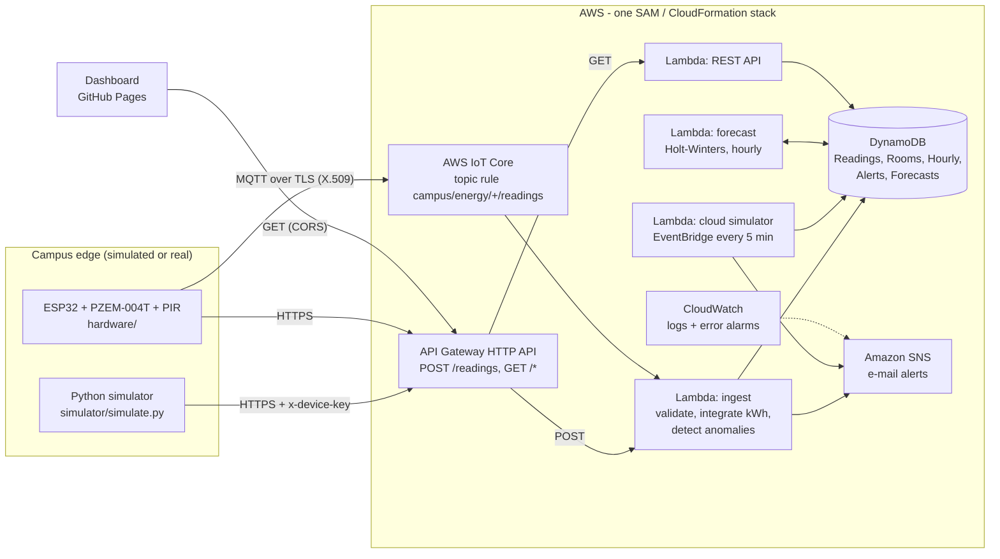

# Cloud-Based Smart Campus Energy Management System

[](https://github.com/bedyrune17/smart-campus-energy-management/actions/workflows/ci.yml)
[](https://bedyrune17.github.io/smart-campus-energy-management/)

**Advanced Cloud Computing · AWS · IoT · Data Analytics**

Colleges waste electricity when classrooms, labs and halls stay powered with nobody inside.
This project is a fully serverless AWS system that **monitors energy consumption room by room,
detects abnormal usage, predicts demand for the next 24 hours, and sends alerts**. It works
without hardware: realistic sensor data is simulated in Python. An ESP32 energy-meter node
can be added later.

**Live dashboard:** https://bedyrune17.github.io/smart-campus-energy-management/
(it shows a demo snapshot until it is connected to your deployed API, as described below)

---

## Features

| Requirement | How it is met |
|---|---|
| Monitor energy consumption | 17 rooms in 5 buildings report power, voltage, current, power factor, occupancy and temperature every 5 minutes. They are rolled up into hourly kWh per room, per building and for the whole campus, with cost (₹) and CO₂. |
| Detect abnormal usage | Rule engine (energy waste in empty rooms, after-hours use, overload or fault, under/over-voltage) plus an adaptive per-room statistical baseline (EWMA z-score). Per-room state lives in DynamoDB. |
| Predict demand | Holt-Winters exponential smoothing with separate weekday, Saturday and Sunday daily profiles. It forecasts 24 h ahead with 95 % intervals and is refitted every hour for each building and the campus. Accuracy is reported as WAPE. |
| Send alerts | Amazon SNS e-mail for high/critical alerts, with a 30-min cooldown per room and alert type. All alerts are stored and listed on the dashboard. CloudWatch alarms fire if a Lambda function fails. |
| Without hardware | A cloud simulator runs on a schedule, a local Python simulator streams data to the API, and anomalies can be forced on demand for demos. |
| With hardware (optional) | ESP32 + PZEM-004T + PIR firmware, sending over HTTPS (device key) or MQTT to AWS IoT Core (X.509 certificates). |

## Architecture



| AWS service | Role |
|---|---|
| **AWS Lambda** (Python 3.12, arm64) | ingestion pipeline, REST API, simulator, forecasting |
| **Amazon API Gateway** (HTTP API) | `POST /readings` for devices, `GET` endpoints for the dashboard, CORS, throttling (20 req/s) |
| **AWS IoT Core** | MQTT ingestion for real devices through a topic rule that invokes the ingest Lambda |
| **Amazon DynamoDB** (on-demand) | time-series readings, room state, hourly roll-ups, alerts, forecasts; TTL expiry |
| **Amazon EventBridge** | schedules: simulator every 5 min, forecast every hour |
| **Amazon SNS** | alert fan-out (e-mail; SMS or webhooks can be added) |
| **Amazon CloudWatch** | logs (14-day retention) and alarms on Lambda errors |
| **AWS CloudFormation / SAM** | the whole backend is one infrastructure-as-code template (`template.yaml`) |
| **GitHub Actions + Pages** | CI (tests + template lint), dashboard hosting, optional OIDC deploy to AWS |

### Data flow for one reading

1. **Validate** room id, numeric ranges and timestamp. A device without NTP gets the server time, and duplicates or out-of-order readings are dropped.
2. **Integrate energy**: kWh = power × time since the room's last reading (capped, so outages are not counted).
3. **Detect anomalies** against rules and the room's learned baseline (see below), applying alert cooldowns.
4. **Store** the raw reading, the room's latest state and baseline, the hourly kWh and waste kWh (room, building, campus), and any alerts.
5. **Notify**: one SNS message per batch summarising alerts at or above `NotifyMinSeverity` (default *high*).

### Anomaly detection

| Alert | Rule | Severity |
|---|---|---|
| `ENERGY_WASTE` | 0 people present, but power above the room's idle threshold (1.5 × standby + 150 W) for ≥ 2 consecutive readings | low / medium / high by kW wasted |
| `AFTER_HOURS` | the same, while the building is closed (per-building timetable) | medium / high |
| `OVERLOAD` | power > 110 % of the room's rated connected load (possible fault or short circuit) | high, or critical above 140 % |
| `UNDER_VOLTAGE` / `OVER_VOLTAGE` | supply outside 230 V ± 10 % | medium / high |
| `UNUSUAL_CONSUMPTION` | z-score > 4 against the room's exponentially weighted mean and variance, learned separately for *occupied* and *idle* behaviour (after a 12-reading warm-up; anomalous readings are kept out of the baseline) | medium |

Each waste alert includes the cost of the waste per hour (₹), and the dashboard totals the avoidable energy and cost for the day.

### Demand forecasting

`backend/src/campus_energy/forecast.py` implements additive Holt-Winters in pure Python (no numpy, so it fits in Lambda without layers):

```
prediction  ŷ(t) = L + S[daytype(t), hour(t)]        daytype ∈ {weekday, Saturday, Sunday}
level       L ← L + α (y − S − L)                     α = 0.05
season      S ← S + γ (y − L − S)                     γ = 0.20
```

It is fitted online over 21 days of hourly history and produces a 24 h forecast with a 95 % interval (±1.96 σ of recent one-step residuals), peak demand, expected cost, and a backtest **WAPE** (Σ|error| / Σ actual; it is used instead of MAPE because MAPE blows up on near-zero night hours). On the simulated campus the day-ahead error is about 17 % for the whole campus and 18–28 % for most buildings. The Admin and Auditorium building is the exception, because auditorium events are random by design (see *Future work*).

## Repository layout

```
template.yaml               AWS SAM template: every AWS resource
deploy.sh / destroy.sh      one-command deploy / teardown (AWS CloudShell or any AWS CLI)
backend/src/
  campus_energy/            shared, dependency-free Python package
    campus.py               buildings, rooms, rated loads, opening hours
    simulator.py            virtual smart meters + occupancy sensors
    anomaly.py              rule engine + adaptive statistical baseline
    forecast.py             Holt-Winters demand forecasting
    pipeline.py             validate -> integrate -> detect -> store -> notify; history backfill
    service.py, router.py   REST API queries and routes
    store.py                DynamoDB store + in-memory store (tests / demo)
    notifier.py             SNS alerts
  handlers/                 Lambda entry points: ingest, api, simulator, forecast
simulator/simulate.py       local simulator CLI (stdlib only)
iot/create-iot-device.sh    register an ESP32 with AWS IoT Core (thing, cert, least-privilege policy)
hardware/                   ESP32 firmware + wiring guide
dashboard/                  static dashboard (HTML/CSS/JS + Chart.js), deployed to GitHub Pages
tools/generate_demo_data.py builds dashboard/demo-data.json by running the real backend in memory
tests/                      pytest suite (DynamoDB tests use moto, no AWS needed)
infra/github-oidc-role.yaml optional IAM role for GitHub Actions -> AWS deploys without keys
```

## Deploy to AWS (about 5 minutes)

You need only an AWS account signed in to the console. Nothing has to be installed on your PC.

1. Open **AWS CloudShell** (the `>_` icon in the console's top bar). It is pre-authenticated, so no access keys are needed.
   Pick your region first (for example *Asia Pacific (Mumbai) ap-south-1*).
2. Run:

   ```bash
   git clone https://github.com/bedyrune17/smart-campus-energy-management.git
   cd smart-campus-energy-management
   bash deploy.sh
   ```

   To also receive alert e-mails, run `ALERT_EMAIL=you@example.com bash deploy.sh` instead and click the
   confirmation link AWS sends you.
3. The script packages the code, deploys the stack, seeds 14 days of history, runs the first forecast, and prints:

   ```
   REST API     : https://abc123.execute-api.ap-south-1.amazonaws.com
   Dashboard    : https://bedyrune17.github.io/smart-campus-energy-management/?api=https://abc123...
   Device key   : 1a2b3c...   (header x-device-key)
   ```
4. **Open the Dashboard link.** The `?api=` parameter connects it to your stack, and the browser remembers it.
   To connect the published site for every visitor, set the repository variable **`API_BASE_URL`**
   (*Settings → Secrets and variables → Actions → Variables*) to the API URL and re-run the *Dashboard* workflow.

Re-running `bash deploy.sh` updates the stack in place. `bash destroy.sh` deletes everything.

### Try it during a demo

```bash
API=$(aws cloudformation describe-stacks --stack-name smart-campus-energy --query "Stacks[0].Outputs[?OutputKey=='ApiUrl'].OutputValue" --output text)
SIM=$(aws cloudformation describe-stacks --stack-name smart-campus-energy --query "Stacks[0].Outputs[?OutputKey=='SimulatorFunctionName'].OutputValue" --output text)
KEY=$(aws cloudformation describe-stacks --stack-name smart-campus-energy --query "Stacks[0].Outputs[?OutputKey=='DeviceApiKey'].OutputValue" --output text)

curl "$API/summary"                               # live KPIs as JSON

# force anomalies; they appear on the dashboard within seconds
aws lambda invoke --function-name "$SIM" --cli-binary-format raw-in-base64-out \
  --payload '{"mode":"inject","scenario":"waste","room_id":"AB1-101"}' /tmp/out.json
aws lambda invoke --function-name "$SIM" --cli-binary-format raw-in-base64-out \
  --payload '{"mode":"inject","scenario":"spike","room_id":"LAB-CS1"}' /tmp/out.json   # overload -> SNS e-mail

# stream the local Python simulator into the cloud
python3 simulator/simulate.py --api "$API" --key "$KEY" --rooms IOT-LAB-1 --interval 30

# send a reading through AWS IoT Core (MQTT path) without any hardware
IOT=$(aws iot describe-endpoint --endpoint-type iot:Data-ATS --query endpointAddress --output text)
aws iot-data publish --endpoint-url "https://$IOT" --topic campus/energy/IOT-LAB-2/readings \
  --cli-binary-format raw-in-base64-out --payload '{"power_w": 4200, "voltage_v": 231, "occupancy": 0}'
```

Scenarios: `waste`, `spike`, `undervoltage`, `overvoltage`.

### Stack parameters

| Parameter | Default | Meaning |
|---|---|---|
| `AlertEmail` | *(empty)* | e-mail address subscribed to the alert topic |
| `SimulatorEnabled` | `true` | the virtual meters; set `SIMULATOR_ENABLED=false bash deploy.sh` once real meters are installed |
| `NotifyMinSeverity` | `high` | lowest alert severity pushed to SNS (all alerts are always stored) |
| `TariffPerKwh` / `Currency` | `8` / `INR` | used for cost figures |

## REST API

Base URL is the `ApiUrl` stack output. All `GET` routes are public and read-only. `POST /readings` requires the `x-device-key` header.

| Route | Returns |
|---|---|
| `GET /summary` | live campus KPIs, per-building totals, forecast headline |
| `GET /rooms` | latest state of every room (status: occupied / idle / wasting / fault / power_issue / offline) |
| `GET /rooms/{room_id}/readings?hours=6` | raw readings for one room |
| `GET /hourly?scope=CAMPUS&hours=48` | hourly kWh and waste kWh (scope = `CAMPUS`, building id or room id) |
| `GET /forecast?scope=CAMPUS` | 24 h forecast points with 95 % interval, peak and backtest error |
| `GET /alerts?hours=24&limit=50` | detected anomalies, newest first |
| `GET /report?days=7` | daily kWh / waste / cost per building |
| `GET /campus` | buildings, rooms, rated loads, tariff |
| `POST /readings` | one reading, a list, or `{"readings": [...]}` |

Reading format (only `room_id` and `power_w` are required):

```json
{"room_id": "AB1-101", "power_w": 2150.4, "voltage_v": 231.2, "current_a": 9.8, "power_factor": 0.95,
 "occupancy": 34, "temperature_c": 25.1, "ts": 1792483200}
```

## Data model (DynamoDB, on-demand)

| Table | Key | Content | TTL |
|---|---|---|---|
| Readings | `room_id` + `ts` | raw readings, plus derived `status` and `wasting` | 7 days |
| Rooms | `room_id` | latest reading, EWMA baselines, waste streak, alert cooldowns | none |
| Hourly | `scope` + `hour` | `energy_kwh`, `waste_kwh` added atomically (`ADD`) | 90 days |
| Alerts | `day` + `sk` (`ts#room#type`) | alert details | 30 days |
| Forecasts | `scope` | the latest 24 h forecast | none |

## Run locally (no AWS needed)

```bash
python -m venv .venv && . .venv/bin/activate        # Windows: .venv\Scripts\activate
pip install -r requirements-dev.txt
pytest -q                                           # 30 tests, DynamoDB mocked with moto
python simulator/simulate.py --dry-run --once       # see what the virtual sensors produce
python tools/generate_demo_data.py                  # rebuild the dashboard's demo snapshot
python -m http.server 8000 --directory dashboard    # open http://localhost:8000
```

## Cost and security

- **Cost:** every service is pay-per-use. With the simulator writing every 5 minutes the stack typically
  costs **well under US$1 per month** (mostly DynamoDB writes), and much of it falls inside the AWS free tier.
  `bash destroy.sh` removes everything.
- **No secrets in the repository.** Deployment runs in CloudShell with the console session. The device key is
  generated per stack (from the CloudFormation stack id) and is only visible in the stack outputs. IoT
  certificates are written to `iot/certs/`, which is git-ignored.
- **Least privilege:** each Lambda gets only the table actions it needs (SAM policy templates). The IoT
  policy lets a device connect only as itself and publish only readings. The optional GitHub deploy role
  trusts only this repository's `main` branch through OIDC.
- **Abuse limits:** API throttling (20 req/s, burst 50), a 256 KB body limit, at most 200 readings per request,
  and range validation on every field.

## CI/CD

- **CI** (`.github/workflows/ci.yml`): tests, `cfn-lint` on the templates, and a simulator smoke test on every push.
- **Dashboard** (`pages.yml`): publishes `dashboard/` to GitHub Pages and injects `API_BASE_URL` if that variable is set.
- **Deploy backend** (`deploy-aws.yml`, optional, manual): deploys the stack from GitHub through OIDC with no stored AWS keys.
  To set it up once, run `aws cloudformation deploy --template-file infra/github-oidc-role.yaml --stack-name smart-campus-github-deployer --capabilities CAPABILITY_NAMED_IAM`,
  then add the repository variables `AWS_DEPLOY_ROLE_ARN` and `AWS_REGION`.

## Demo script (for the presentation)

1. Open the dashboard: live demand, today's energy and cost, avoidable waste, the forecast and alerts.
2. Explain the chart: the grey line is actual hourly energy and the violet dashed line is the forecast with its 95 % band. Point out the lunch dip and the quiet weekend.
3. Filter by building (Laboratory Complex), then open **Computer Lab 1** to show power against occupancy and the waste threshold.
4. In CloudShell, inject `waste` into `AB1-101`. Within one refresh the room turns *Wasting* and an alert with its ₹ cost per hour appears.
5. Inject `spike` into `LAB-CS1` to show a critical overload alert and the SNS e-mail.
6. Show `template.yaml` (infrastructure as code), the DynamoDB tables, and the CloudWatch logs for the ingest Lambda.
7. Optionally publish one MQTT message with `aws iot-data publish` to show the IoT Core path.

## Future work

- An event calendar (auditorium bookings, exams, holidays) as a forecast input. Random events are why the Admin and Auditorium building has the largest forecast error.
- Closed-loop control: smart relays or IR blasters that switch off lights and AC after a waste alert is confirmed.
- Amazon Timestream or S3 + Athena for long-term analytics, and QuickSight reports.
- Gradient-boosted or LSTM forecasting on SageMaker once months of real meter data exist.
- Camera-based people counting or CO₂ sensors for more accurate occupancy than PIR.

## License

MIT, see [LICENSE](LICENSE).
